# Отчёт по практической работе: «Работа в консоли»

## 1. Перемещение между директориями и просмотр списка файлов (п. 1–3)

Для навигации по файловой системе использовалась команда `cd`:
```bash
cd ..          # Переход в родительскую директорию (на уровень выше)
cd .           # Переход в текущую директорию
cd EternalOS   # Переход во вложенную папку EternalOS
cd ..          # Возврат на уровень выше
```
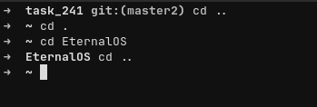

Для вывода списка файлов (включая скрытые файлы, начинающиеся с точки) с подробной информацией, сортировкой по размеру и ограничением вывода первыми 15 строками использовалась комбинация команд:
```bash
ls -laS | head -n 15
```
* `-l` — подробный табличный вывод (права доступа, владелец, размер, дата изменения);
* `-a` — отображение всех файлов, включая скрытые (`.zcompdump`, `.zsh_history` и др.);
* `-S` — сортировка по размеру файла;
* `head -n 15` — ограничение вывода первыми 15 строками.

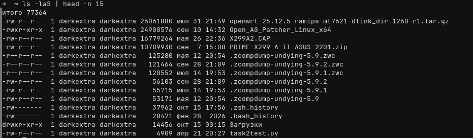

---

## 2. Создание каталогов и файлов (п. 4–5)

### Создание папки с несколькими уровнями подпапок
С помощью команды `mkdir` с флагами `-p` (создание всех промежуточных директорий) и `-v` (вывод отчёта о каждом созданном каталоге), а также механизма раскрытия скобок `{}` была создана многоуровневая структура папок:
```bash
mkdir -pv test/{temp1/{1,2},temp2/{1,2}}
```
Результат выполнения:
```text
mkdir: создан каталог 'test'
mkdir: создан каталог 'test/temp1'
mkdir: создан каталог 'test/temp1/1'
mkdir: создан каталог 'test/temp1/2'
mkdir: создан каталог 'test/temp2'
mkdir: создан каталог 'test/temp2/1'
mkdir: создан каталог 'test/temp2/2'
```
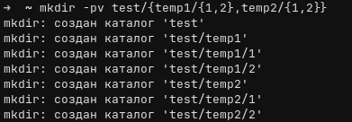

### Создание файла и запись в него нескольких строк текста
Переход во вложенную директорию и создание файла `file.txt` с записью трёх строк текста с помощью конструкции *Here Document* (`cat << EOF`):
```bash
cd test/temp2/2
cat << EOF > file.txt
123123
stop
start
EOF
```
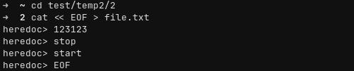

---

## 3. Перемещение, переименование и копирование файла (п. 6–8)

### Перемещение файла из одной директории в другую
Файл `file.txt` был перемещён из текущей директории (`~/test/temp2/2`) в каталог `~/test/temp1/1`:
```bash
mv file.txt ~/test/temp1/1/file.txt
ls
ls ~/test/temp1/1
```
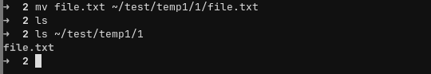

### Переименование файла
Находясь в директории `~/test/temp1/1`, файл `file.txt` был перемещён обратно в `~/test/temp2/2` с одновременным переименованием в `renamed_file.txt`:
```bash
mv file.txt ~/test/temp2/2/renamed_file.txt
```


### Копирование файла из одной директории в другую
Из директории `~/test/temp2/2` файл `renamed_file.txt` был скопирован в директорию `~/test/temp1/` под именем `copt_file.txt` с помощью утилиты `cp`:
```bash
ls
cp renamed_file.txt ~/test/temp1/copt_file.txt
ls ~/test/temp1/
```
Результат проверки `ls ~/test/temp1/`:
```text
1  2  copt_file.txt
```
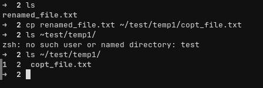

---

## 4. Итоговая структура созданных каталогов

Для просмотра полной иерархии созданных папок и файлов использовался рекурсивный вывод содержимого каталога `~/test`:
```bash
ls -laR ~/test
```

Дерево созданной структуры каталогов и файлов:
```text
~/test/
├── temp1/
│   ├── 1/
│   ├── 2/
│   ├── copt_file.txt
│   └── copt_file_orig.txt
└── temp2/
    ├── 1/
    └── 2/
        └── renamed_file.txt
```
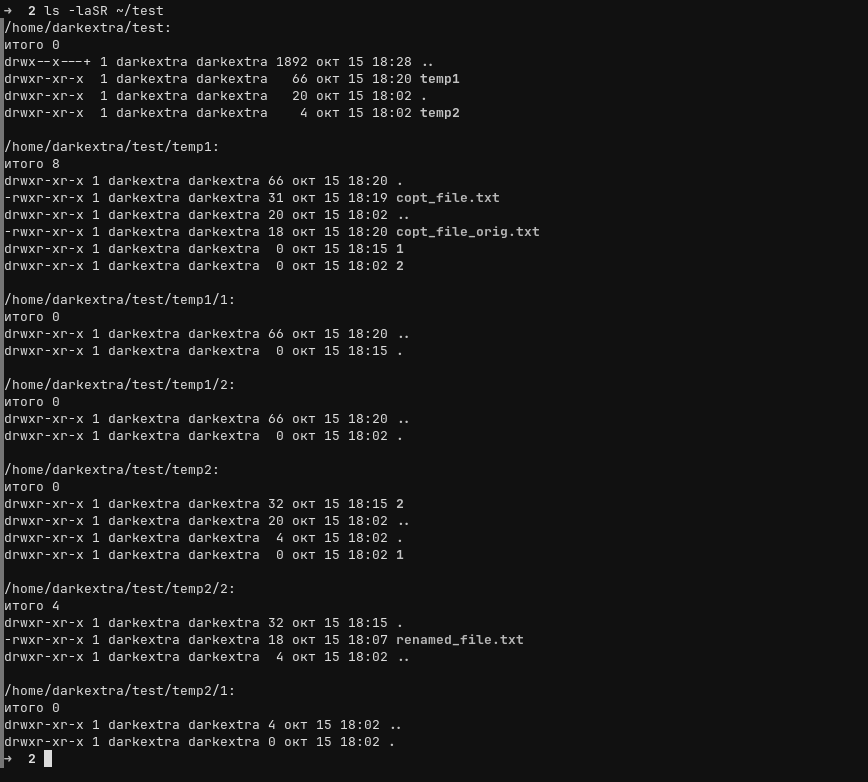

---

## 5. Сравнение содержимого двух файлов (п. 9)

Для сравнения файлов использовалась команда `diff` с флагами `-u` (унифицированный формат вывода различий) и `-s` (явное сообщение в случае идентичности файлов):

1. Сравнение идентичных файлов (`renamed_file.txt` и его полной копии `copt_file_orig.txt`):
```bash
cp renamed_file.txt ~/test/temp1/copt_file_orig.txt
diff -us ~/test/temp2/2/renamed_file.txt ~/test/temp1/copt_file_orig.txt
```
**Результат:**
```text
Файлы /home/darkextra/test/temp2/2/renamed_file.txt и /home/darkextra/test/temp1/copt_file_orig.txt идентичны
```

2. Сравнение файлов с разным содержимым (после добавления строки в `copt_file.txt`):
```bash
diff -us ~/test/temp2/2/renamed_file.txt ~/test/temp1/copt_file.txt
```
**Результат:**
```diff
--- /home/darkextra/test/temp2/2/renamed_file.txt 2026-10-15 18:07:12.333916262 +0400
+++ /home/darkextra/test/temp1/copt_file.txt      2026-10-15 18:19:29.231129940 +0400
@@ -1,3 +1,4 @@
 123123
 stop
 start
+12312312
```
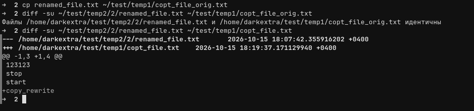

---

## 6. Сортировка содержимого файла (п. 10)

Для сортировки строк внутри файла `renamed_file.txt` использовалась утилита `sort`:

* **По возрастанию (в алфавитно-лексикографическом порядке):**
```bash
sort renamed_file.txt
```
Результат:
```text
123123
start
stop
```

* **По убыванию (в обратном порядке, флаг `-r`):**
```bash
sort -r renamed_file.txt
```
Результат:
```text
stop
start
123123
```
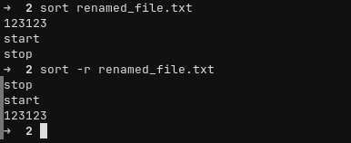

---

## 7. Поиск файла по имени (п. 11)

Для поиска файла `renamed_file.txt` во всей иерархии каталога `~/test` без ручного перехода по папкам использовалась утилита `find`:
```bash
find ~/test -name renamed_file.txt
```
**Результат:**
```text
/home/darkextra/test/temp2/2/renamed_file.txt
```
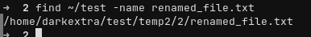

---

## 8. Удаление созданных файлов и каталогов (п. 12)

Для полного рекурсивного удаления корневой папки задания `~/test` со всеми вложенными подкаталогами и файлами была выполнена команда `rm -rf`, а затем проверено отсутствие папки в домашней директории:
```bash
rm -rf ~/test
ls
cd ..
cd ~/
ls | grep "test"
```
**Результат проверки:** в выводе `ls | grep "test"` остался только сторонний скрипт `task2test.py`, каталог `test` и всё его содержимое успешно удалены.

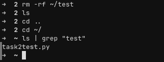


---

## 9. Разница между абсолютным и относительным путём

* **Абсолютный (полный) путь** — указывает точное местоположение файла или папки, начиная от **корневого каталога системы (`/`)**. Он всегда начинается со слэша `/` (или символа `~`, который автоматически раскрывается оболочкой в абсолютный путь к домашней директории пользователя `/home/darkextra`). Абсолютный путь работает одинаково независимо от того, в какой папке сейчас находится пользователь.
  * *Примеры из работы:* `/home/darkextra/test/temp2/2/renamed_file.txt`, `~/test/temp1/1/file.txt`.

* **Относительный путь** — указывает расположение объекта **относительно текущей рабочей директории (`pwd`)**, в которой находится пользователь в данный момент. Он не начинается со слэша `/` и может использовать специальные обозначения: `.` (текущая папка) и `..` (родительская папка на уровень выше).
  * *Примеры из работы:* `test/temp2/2`, `renamed_file.txt`, `cd ..`.
