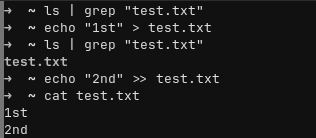
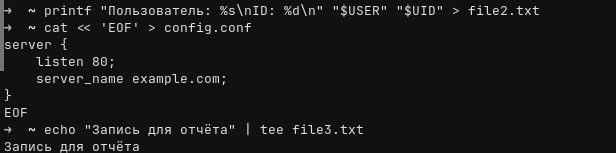
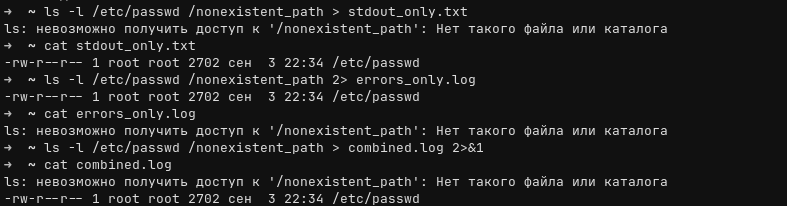
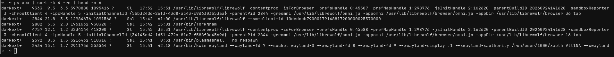

# Отчёт по практической работе: «Перенаправление ввода-вывода и конвейеры в Linux»

---

## 1. Стандартные потоки (`stdin`, `stdout`, `stderr`) и файловые дескрипторы

При запуске любого процесса ядро Linux автоматически выделяет ему три стандартных канала ввода-вывода. Внутри системы работа с ними идёт через **файловые дескрипторы (FD)** — целые числа, указывающие на открытые потоки данных:

* **`stdin` (Standard Input, дескриптор `0`)** — стандартный поток ввода. Через него программа получает данные для обработки. По умолчанию привязан к клавиатуре терминала, но в него можно подать содержимое файла или вывод другой программы.
* **`stdout` (Standard Output, дескриптор `1`)** — стандартный поток вывода. Сюда программа отправляет штатный результат своей работы. По умолчанию выводится на экран терминала.
* **`stderr` (Standard Error, дескриптор `2`)** — стандартный поток ошибок. Используется для вывода сообщений о сбоях, предупреждений и диагностики. По умолчанию тоже выводится на экран терминала.

### Чем отличаются `stdout` и `stderr`?
Несмотря на то что оба потока по умолчанию отображаются в одном окне терминала, они разделены по трём причинам:
1. **Чистота данных:** Когда мы сохраняем результат работы команды в файл или передаём его дальше по конвейеру (`|`), текст ошибок из `stderr` не смешивается с полезными данными из `stdout` и не ломает их формат.
2. **Разная буферизация:** Поток `stdout` при записи в файл или конвейер буферизуется (данные копируются в памяти и сбрасываются блоками), а `stderr` выводится без буферизации — мгновенно, чтобы при зависании или падении процесса мы сразу увидели ошибку.
3. **Независимое перенаправление:** Стандартный оператор `>` и конвейер `|` по умолчанию захватывают только `stdout` (`1`), оставляя ошибки (`2`) на экране.

---

## 2. Операторы перенаправления `>` и `>>`, чтение и создание файлов

### Как работают `>` и `>>`
Оба оператора перенаправляют стандартный вывод (`stdout`, FD `1`) в указанный файл. Если файла нет — оболочка создаёт его автоматически. Разница заключается в работе с уже существующим файлом:
* **`>` (перезапись):** оболочка очищает целевой файл до нулевого размера ещё до старта команды и записывает новые данные с самого начала.
* **`>>` (дозапись):** старое содержимое файла сохраняется, а новые строки дописываются в самый конец файла.

### Проверка `>`, `>>` и вывод файла без текстового редактора
Проверим отсутствие файла `test.txt` в домашней директории, создадим его через `>`, допишем вторую строку через `>>` и выведем содержимое с помощью утилиты `cat`:

```bash
ls | grep "test.txt"
echo "1st" > test.txt
ls | grep "test.txt"
echo "2nd" >> test.txt
cat test.txt
```

Результат выполнения:
```text
test.txt
1st
2nd
```

*(Помимо `cat`, прочитать файл без текстовых редакторов можно командами `less`, `head`, `tail` или `tac`).*



### Создание файлов с содержимым без текстовых редакторов
Помимо базового `echo`, создать и заполнить файл данными прямо из CLI можно ещё тремя удобными способами:

1. **Через `printf`** (позволяет гибко форматировать строки и подставлять переменные окружения):
   ```bash
   printf "Пользователь: %s\nID: %d\n" "$USER" "$UID" > file2.txt
   ```
2. **Через `cat` и конструкцию Here-Document (`<< 'EOF'`)** — удобно для записи многострочных конфигов (одинарные кавычки вокруг `'EOF'` отключают подстановку переменных внутри блока):
  
3. **Через утилиту `tee`** — читает поток из `stdin`, выводит его на экран и одновременно сохраняет в файл:
   ```bash
   echo "Запись для отчёта" | tee file3.txt
   ```



---

## 5. Практика перенаправления `stdout` и `stderr`

Для наглядной проверки используем команду `ls -l /etc/passwd /nonexistent_path`. Здесь файл `/etc/passwd` реально существует в системе (информация о нём пойдёт в `stdout`, дескриптор `1`), а пути `/nonexistent_path` нет (ошибка доступа пойдёт в `stderr`, дескриптор `2`).

### 5.1. Перенаправление только `stdout` в файл
Оператор `>` (или явно `1>`) перехватывает только стандартный вывод. Ошибка остаётся на экране терминала, а штатный вывод сохраняется в `stdout_only.txt`:

```bash
ls -l /etc/passwd /nonexistent_path > stdout_only.txt
cat stdout_only.txt
```

Результат:
```text
ls: невозможно получить доступ к '/nonexistent_path': Нет такого файла или каталога
-rw-r--r-- 1 root root 2702 сен  3 22:34 /etc/passwd
```

### 5.2. Перенаправление только `stderr` в файл
Указываем дескриптор `2>` для перехвата потока ошибок. Теперь строка с `/etc/passwd` сразу выводится в терминал, а текст ошибки записывается в `errors_only.log`:

```bash
ls -l /etc/passwd /nonexistent_path 2> errors_only.log
cat errors_only.log
```

Результат:
```text
-rw-r--r-- 1 root root 2702 сен  3 22:34 /etc/passwd
ls: невозможно получить доступ к '/nonexistent_path': Нет такого файла или каталога
```

### 5.3. Перенаправление `stdout` и `stderr` в один файл
Чтобы собрать весь вывод в один лог, сначала направляем `stdout` в файл (`> combined.log`), а затем привязываем дескриптор `2` к текущему месту назначения дескриптора `1` (`2>&1`). В современных оболочках Bash/Zsh это также можно записать короче через `~> combined.log` или `&> combined.log`:

```bash
ls -l /etc/passwd /nonexistent_path > combined.log 2>&1
cat combined.log
```

Результат (оба потока оказались внутри файла `combined.log`):
```text
ls: невозможно получить доступ к '/nonexistent_path': Нет такого файла или каталога
-rw-r--r-- 1 root root 2702 сен  3 22:34 /etc/passwd
```


### 5.4. Раздельное перенаправление `stdout` и `stderr` в разные файлы
Указываем в одной команде разные файлы для первого и второго дескрипторов. На экран ничего не выводится — успешный результат и ошибки сразу разносятся по своим файлам:

```bash
ls -l /etc/passwd /nonexistent_path 1> success.txt 2> errors.txt
cat success.txt
cat errors.txt
```



---

## 7. Передача данных через стандартный ввод `stdin` 

Подать данные на `stdin` (дескриптор `0`) команде можно через оператор `<` (чтение из файла), через конвейер `|` или с помощью конструкции **Here-String (`<<<`)**, которая передаёт строку текста напрямую на стандартный ввод программы.

Передадим строку утилите `tr` через `<<<`, чтобы перевести все символы из нижнего регистра в верхний, и проверим код возврата последней команды через `$?` (`0` означает успешное выполнение без ошибок):

```bash
tr 'a-z' 'A-Z' <<< "hello linux world"
echo $?
```

Результат:
```text
HELLO LINUX WORLD
0
```

Также классический вариант передачи файла через `stdin`:
```bash
wc -l < /etc/passwd
```


---

## 8. Работа с пустым устройством `/dev/null`

`/dev/null` — это специальное виртуальное символьное устройство в Linux («чёрная дыра»). Всё, что записывается в `/dev/null`, ядро сразу отбрасывает, а при попытке прочитать `/dev/null` через `cat` возвращается пустой ответ (признак конца файла `EOF`):

```bash
ls /dev/null
cat /dev/null
```

Чтобы подавить ненужный вывод команды, достаточно перенаправить нужный поток в `/dev/null`:

```bash
# Скрыть только ошибки (например, ошибки отказа в доступе):
ls -l /etc/passwd /nonexistent_path 2> /dev/null

# Полностью заглушить команду (и stdout, и stderr):
ls -l /etc/passwd /nonexistent_path &> /dev/null
```


---

## 9. Конвейеры (`|`) и их отличие от перенаправления `>`

### Чем отличается конвейер `|` от перенаправления `>`?
* **Перенаправление (`>` / `>>`)** отправляет поток данных из процесса в **файл на диске** (или виртуальное устройство вроде `/dev/null`). Справа от оператора `>` всегда стоит имя файла.
* **Конвейер (`|`, pipe)** связывает две программы напрямую через буфер в оперативной памяти: поток `stdout` первой команды сразу подаётся на поток `stdin` второй команды без создания временных файлов на диске. Справа от `|` всегда стоит другая команда.

### Сборка конвейера из трёх команд
Соберём конвейер из трёх утилит, чтобы вывести топ процессов в системе по потреблению оперативной памяти:

```bash
ps aux | sort -k 4 -rn | head -n 6
```

**Как работает эта цепочка:**
1. `ps aux` — выводит полный список запущенных процессов всех пользователей с информацией об использовании CPU и RAM.
2. `sort -k 4 -rn` — принимает список процессов через `stdin` и сортирует строки по 4-му столбцу (`-k 4`, колонка `%MEM`) как числа (`-n`) в обратном порядке по убыванию (`-r`).
3. `head -n 6` — берёт отсортированный поток из `stdin` и оставляет только первые 6 строк (самые «тяжёлые» процессы, такие как `librewolf`, `forkgram`, `plasmashell`, `kwin_wayland`).


